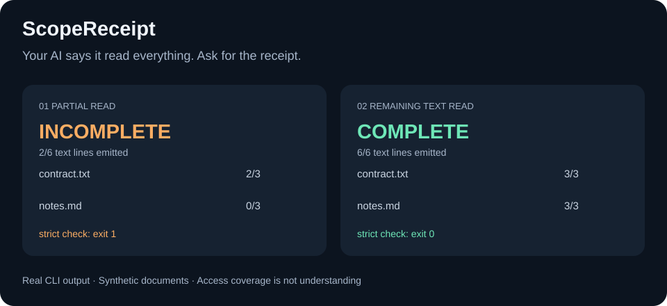

# ScopeReceipt

**Your AI says it read everything. Ask for the receipt.**

[中文说明](docs/README.zh-CN.md) · [MCP setup](docs/MCP.md) · [MIT license](LICENSE)



ScopeReceipt tracks **which document text your agent accessed** and shows what it missed.
Use it when the task is “review the whole folder”, not just “find a relevant passage”.

Local CLI + MCP stdio server. Python 3.10+. No runtime dependencies for text/ZIP/MCP;
PDF text extraction uses optional PyMuPDF. Early release **v0.2.0**, not published on PyPI.

## Try it in 30 seconds

From this repository:

```bash
python scripts/demo.py
```

No API key, model, network connection, or installation needed. The demo uses synthetic
documents, checks real CLI exit codes, and cleans up its temporary receipts.

```text
Read 2 of 6 lines    → INCOMPLETE → strict check exits 1
Read the remaining 4 → COMPLETE   → strict check exits 0
```

The graphic above is generated from that run with `python scripts/demo.py --svg docs/demo.svg`.
It is a coverage demonstration, not a benchmark of an AI model.

## Audit your documents

```bash
python -m pip install -e .
# Optional PDF support:
python -m pip install -e '.[pdf]'

scopereceipt --state /absolute/path/to/receipts scan /absolute/path/to/documents
scopereceipt --state /absolute/path/to/receipts read notes.md --start 1 --end 20
scopereceipt --state /absolute/path/to/receipts report --strict
scopereceipt --state /absolute/path/to/receipts report --format json
```

`scan` accepts a folder, a single file, or a ZIP. `read` uses inventory-relative paths.
Text ranges are line numbers; PDF ranges are page numbers, both 1-based and inclusive.
The default read is 80 text lines or one PDF page. Results over 100 KiB are refused;
request a smaller range. Add `--state` **before** the subcommand.

The JSON report includes `missing_ranges`, changed files, added/removed paths, and a
`run_id`. Repeated and overlapping reads count once. Source changes invalidate old
coverage. New files also prevent a complete report until the scope is rescanned.

Exit codes: **0** = successful command/passed strict check; **1** = incomplete strict
check; **2** = error. Without `--strict`, a valid incomplete report exits 0.

## Give an agent tracked reading tools

First scan the corpus yourself. Then have an MCP client launch:

```bash
python -m scopereceipt.mcp_server --state /absolute/path/to/receipts
```

The server exposes just three tools:

| Tool | Purpose |
| --- | --- |
| `scope_inventory` | List the fixed scope. Listing does not count as reading. |
| `scope_read` | Emit text and automatically record the emitted range. |
| `scope_report` | Show coverage, omissions, and source changes. |

The agent cannot call `scan`, choose a different state directory, or supply its own
receipt through MCP. A changed manifest requires a server restart. See
[configuration and the trust model](docs/MCP.md).

## What a receipt proves

It records **text emitted through this interface**, not that the model understood it.
MCP events are saved after the response is written and flushed. This is not an
end-to-end client acknowledgement; clients may truncate or discard the response.

| Case | Coverage behavior |
| --- | --- |
| UTF-8 text | Counts emitted line ranges; empty text files have zero units. |
| PDF | Counts pages with nonempty extracted text. Images/figures are not inspected. |
| Scanned/blank PDF page | Remains incomplete; OCR/visual review is not implemented. |
| Unsupported or non-UTF-8 file | Listed and blocks complete coverage. |
| Changed/deleted file | Old coverage no longer counts. |
| Added file | Blocks COMPLETE and requests a rescan. |
| Reads through other tools | Not observed; absence of a receipt is not proof of no access. |

The inventory ignores symlinks and common generated directories (`.git`, `.venv`,
`venv`, `node_modules`, `__pycache__`, `.scopereceipt`). “All files” always means the
explicit inventory under these rules. ZIP member names are checked and read without
extracting them. Limits: 500 files, 50 MiB per file, 500 MiB total.

Receipts are local JSON, not signed or tamper-proof. An agent with shell/filesystem
access can bypass the tools or edit state. Enforce routing and isolate the state
directory independently if you need a stronger boundary. Use one writer per state
directory; concurrent scans/readers are not a supported transactional workload.

No model calls, telemetry, or uploads are performed by ScopeReceipt. The MCP client
may send returned text to its model provider. Keep receipt directories private:
they contain source paths, hashes, and access metadata, though not document bodies.

## Develop

```bash
python -m unittest discover -s tests -v
python scripts/demo.py
python -m pip wheel . --no-deps --wheel-dir dist
```

Tests include real MCP subprocess exchanges, missing ranges, inventory changes,
stale runs, invalid arguments, UTF-8 content, failed output, ZIPs and optional PDF
cases. CI is configured for Windows, Linux and macOS; local results are not a claim
that hosted CI has run. Full desktop-agent interoperability remains to be tested.

Next: real client feedback, visual/OCR receipts, and adapters for existing read tools.
Contributions and reproducible examples welcome. See [CONTRIBUTING.md](CONTRIBUTING.md).
